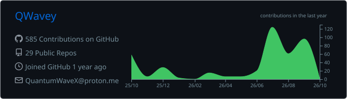
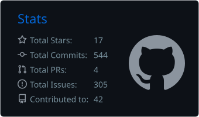
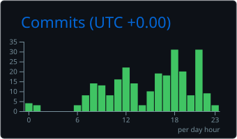
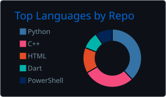
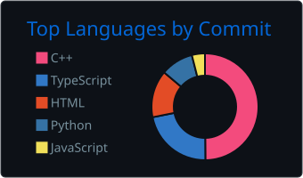

# Hey Hey! Greetings from Germany!

I'm QWavey. I build software with friends, break things to fix them better, and try to leave the world a little more secure than I found it.

I've been on a PC and a mobile device since I was six years old. My first device was a Samsung S3 mini, lol. Young, I know, but that's where my experience comes from. I wake up with it every day.

Coming up with new project ideas is what keeps me going. Friends matter most to me.

## Get in Touch

Open an issue on any of my repos if you want to reach me. My Discord is sniper74.

## GitHub Analytics

  

  
  

  
  

The repos here cover software development, security research, and tools that try to make things work better.

---

## Disclaimer

By using any of my code, you take full responsibility for what happens with it. That includes system failures, data loss, and unintended damage. I'm not liable for consequences of using it. If you're unsure what you're doing, stop, cancel the project, and ask a professional or me first.

Some projects include code, suggestions, or logic produced with AI tools. I review, test, and refine all of that output, and I check that it works myself, sometimes until midnight. I'm not just vibecoding and pushing it out. Still, use your own judgment and do your own due diligence.

The ideas are always mine. I never ask an AI to "give me project ideas." Once a project is underway, I sometimes ask an AI for new suggestions and look at what comes back. Most of it doesn't get picked (about 9 in 10).

If you don't like AI-assisted code, you're free to move on from my profile. I understand.

---

Sidenote: Jesus loves you!
